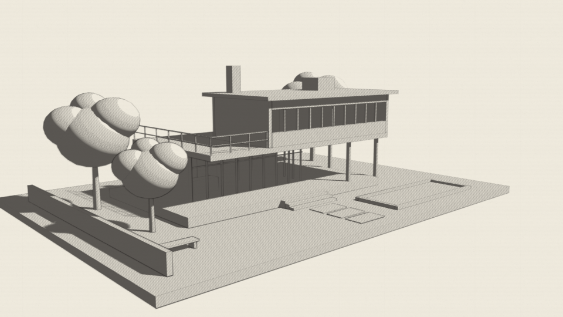
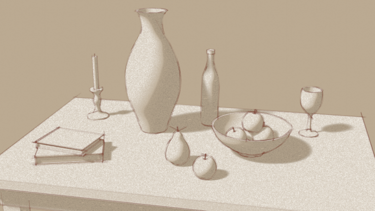
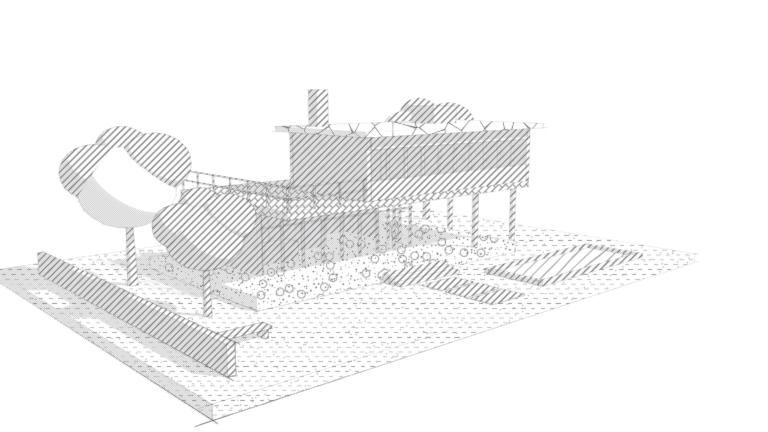
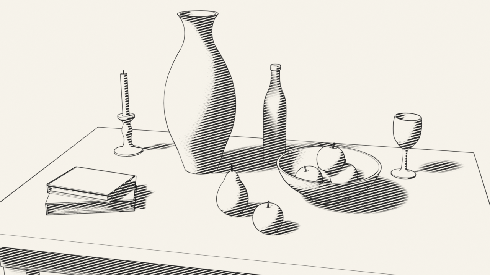
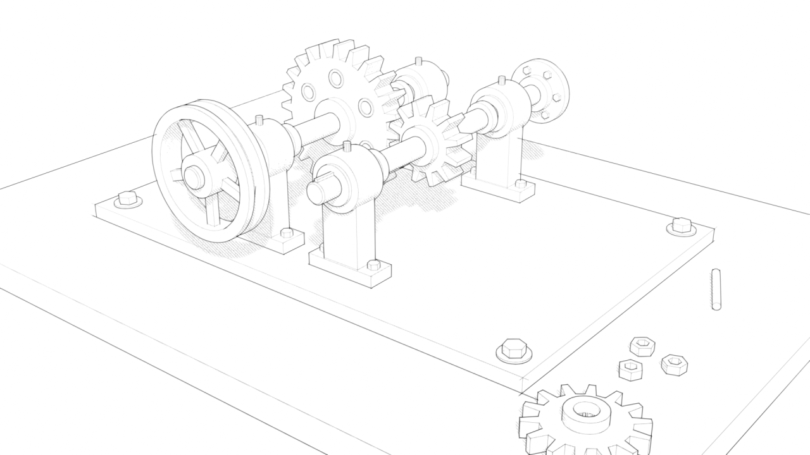
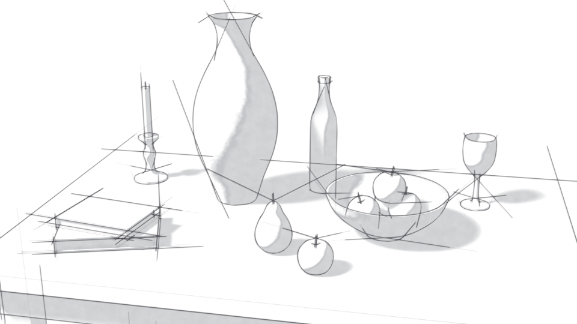
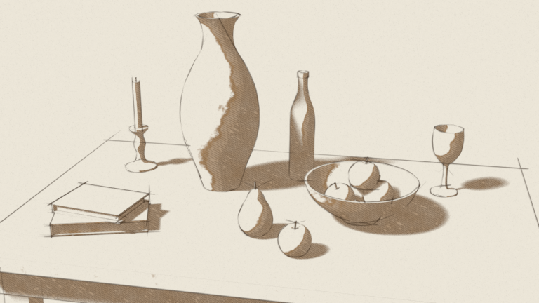
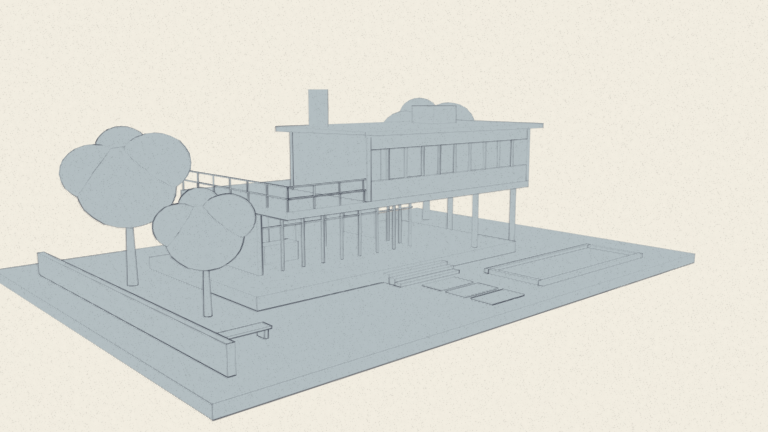
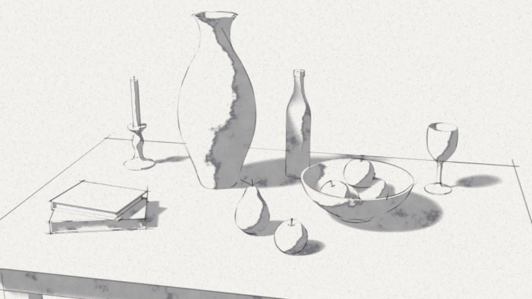
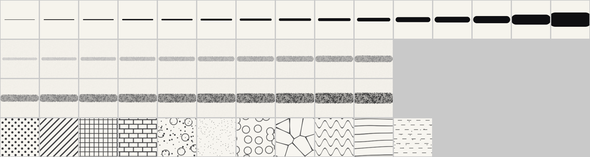

# Matita per Blender

[English](README.md) · **Italiano**

Matita trasforma qualsiasi scena di Blender in un'illustrazione disegnata a mano: linee a
china o a matita, tratteggi, retini, campiture d'architettura, acquerelli e lumeggiature a
gessetto, su carta con la sua grana. Contiene 29 stili pronti, dalla penna tecnica e il disegno
da brevetto fino a Leonardo, Michelangelo, Piranesi, Dürer, Rembrandt, Canaletto e Hokusai.



| | |
|---|---|
|  |  |
| *Tre matite su carta tinta* | *Retini d'architettura assegnati per oggetto* |
|  |  |
| *Xilografia: le luci scavate nel nero pieno* | *Disegno da brevetto con pennini ISO* |
|  |  |
| *Design di arredo e prodotto* | *Rembrandt: inchiostro bruno e velature dense* |
|  |  |
| *Hokusai: colori piatti e contorni indaco* | *Inchiostro diluito (sumi-e) su carta washi* |
|  |  |
| *Figurino di moda* | *Menu visivi: punte delle penne, matite 9H–9B, retini* |

## Funzioni

- **Linee** dal Line Art di Blender: profili, spigoli, intersezioni, linee di costruzione e
  linee nascoste a trattini, con estensione oltre gli spigoli, ripassi, tremolio della mano e
  animazione "boil".
- **Strumento**: spessore libero in pixel, **penna tecnica** (ISO 0,13–2,0 mm), **fineliner**
  (0,05–0,8 mm) o **matita** (9H–9B), scelti da menu visivi. Con le penne profili, linee
  nascoste e costruzione possono avere ciascuno la propria punta, come nel disegno tecnico.
- **Formato foglio**: da A5 ad A0 oppure automatico (300 dpi). Serve solo a tradurre i
  millimetri delle punte in pixel: non dipende dalla scala né dalle unità del modello.
- **Ombreggiatura dalle luci vere della scena**: tratteggio incrociato, parallelo, ondulato,
  zig-zag, scarabocchio, intreccio, circolare; retino, puntinato, campitura delle ombre e
  acquerello. Le luci restano quelle di Blender: l'add-on non le modifica mai e si adatta con
  *Esposizione*.
- **11 retini d'architettura**: punti, linee, griglia, mattoni, calcestruzzo, sabbia/intonaco,
  ghiaia, pietra, isolante, legno, terreno. A tono (nelle ombre) o come campitura uniforme del
  materiale, per tutta la scena o **per singolo oggetto**.
- **Lumeggiature** a gessetto, **tratteggio in negativo** (xilografia) e **colore per
  oggetto** preso dai materiali originali.
- **14 tipi di carta** con grana, fibre e trama (vergata, acquerello, telata, washi, kraft,
  pergamena…).
- **Veloce anche con scene pesanti**: calcolo linee *Veloce*, linee congelate e *Ricongela da
  sole*, che tiene le linee ferme mentre selezioni e giri la vista e le ricalcola una sola
  volta quando ti fermi.
- **Preset personali** salvati come file `.json` condivisibili.
- **3 scene demo** (architettura, meccanica, natura morta) per provare tutti gli stili.

## Stili

| Tecnico | Artistico | Design | VIP |
|---|---|---|---|
| Penna tecnica | Schizzo architettonico | Arredo e prodotto | Leonardo |
| Blueprint | Matita | Automotive | Michelangelo |
| Struttura (tutti i bordi) | Puntinato | Moda | Piranesi |
| Disegno da brevetto | Retino | Plastico bianco | Dürer |
| Lavagna | Concept acquerello | Interior | Rembrandt |
| | Pennarello | | Canaletto |
| | Carboncino | | Hokusai |
| | Inchiostro diluito | | |
| | Linea chiara | | |
| | Urban sketching | | |
| | Tre matite | | |
| | Xilografia | | |

## Requisiti

- Blender **4.3 o successivo** (sviluppato e provato su Blender 5.3)
- EEVEE (impostato automaticamente all'attivazione)

## Installazione

1. Scarica `matita-<versione>.zip` dalla pagina [Releases](../../releases), senza
   decomprimerlo.
2. In Blender: *Modifica › Preferenze › Estensioni*, apri il menu in alto a destra e scegli
   **Installa da disco…**, poi seleziona lo zip.
3. Apri la barra laterale del viewport 3D (`N`) e scegli la scheda **Matita**.

Se avevi installato una versione di prova con un altro nome, disinstallala prima.

## Primi passi

1. Scegli uno stile dal menu *Stile* e premi **Attiva Matita** (oppure prova una demo da
   *Scene demo*).
2. Regola l'aspetto nei sotto-pannelli: *Carta*, *Linee* (con lo strumento), *Tratteggio*,
   *Retino*, *Acquerello*, *Colore per oggetto*, *Lumeggiature*, *Luce e toni*.
3. Premi **Render** in *Render e prestazioni*.

Per dare un retino d'architettura a un oggetto: attiva *Retino*, seleziona l'oggetto, scegli il
motivo in *Retino dell'oggetto* e usa *Applica ai selezionati* per gli altri.

## Consigli per le prestazioni

- Il Line Art ricalcola tutte le linee a ogni modifica della scena, **anche quando selezioni
  un oggetto**. Nelle scene pesanti attiva **Ricongela da sole** (in *Render e prestazioni*):
  le linee restano ferme mentre lavori e si aggiornano una volta, mezzo secondo dopo che ti
  fermi.
- Con *Blocca camera alla vista* attivo, girare la vista in camera sposta la camera e ogni
  passo ricalcola le linee: anche qui risolve *Ricongela da sole*.
- *Calcolo linee: Veloce* salta le intersezioni tra oggetti (circa 3 volte più rapido).

## Struttura del progetto

```
matita/              l'estensione (il contenuto dello zip)
  blender_manifest.toml     id, versione, versione di Blender
  core.py                   setup della scena, sincronizzazione, linee congelate, handler
  nodes.py                  node tree: materiale di superficie e World della carta
  props.py                  impostazioni (salvate sul World della carta) e proprietà oggetto
  presets.py                stili integrati e preset personali
  papers.py / tips.py / tones.py   carte, strumenti da disegno, retini
  ui.py                     pannelli e operatori
  scenes.py                 scene demo
  papers/ tips/ tones/      icone dei menu visivi
tools/                      script che rigenerano le icone
docs/images/                immagini di questo README
```

## Creare lo zip

```bash
blender --command extension build --source-dir matita --output-dir .
blender --command extension validate matita-<versione>.zip
```

Le icone si rigenerano con:

```bash
blender --background --factory-startup --python tools/make_paper_previews.py
blender --background --factory-startup --python tools/make_tool_previews.py
```

## Licenza

[GPL-3.0-or-later](LICENSE), come Blender.
Gli stili "VIP" sono interpretazioni delle tecniche di artisti di pubblico dominio; nessuna opera
viene riprodotta. Codice, scene demo, icone e immagini sono stati creati per questo progetto
(scene e icone sono generate proceduralmente dall'add-on stesso).

Blender è un marchio registrato della Blender Foundation. Matita è un progetto
indipendente, non affiliato né approvato dalla Blender Foundation.
