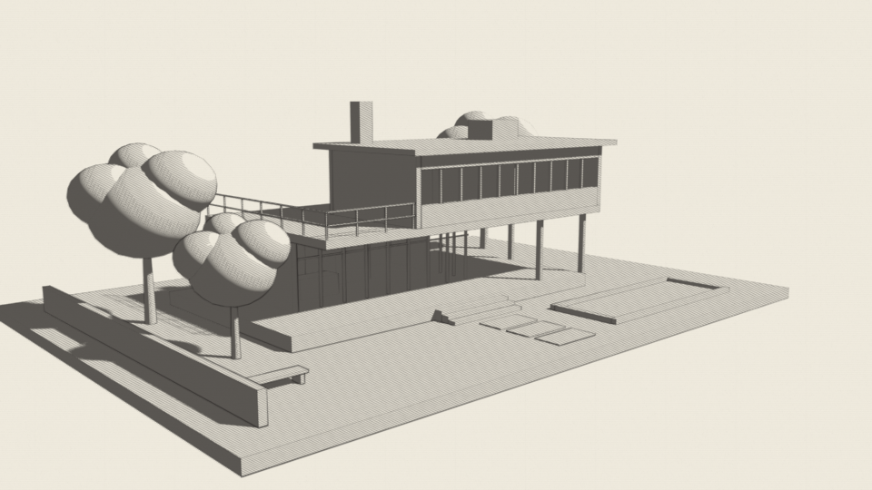
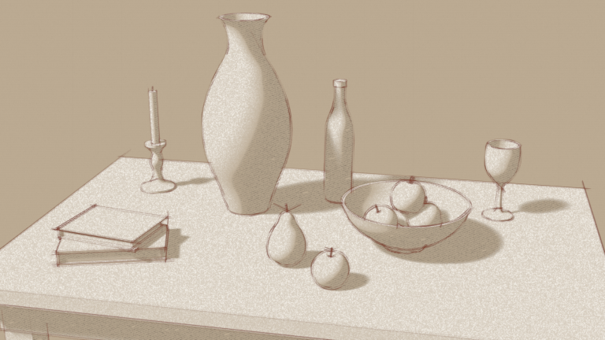
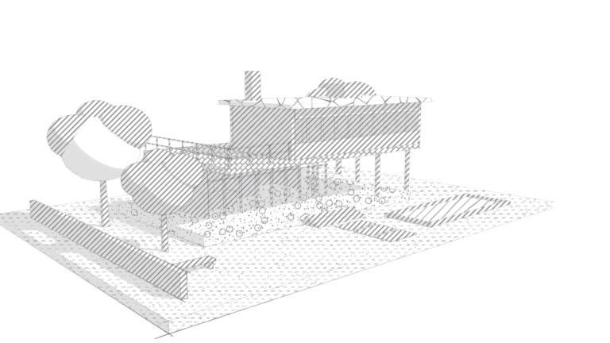
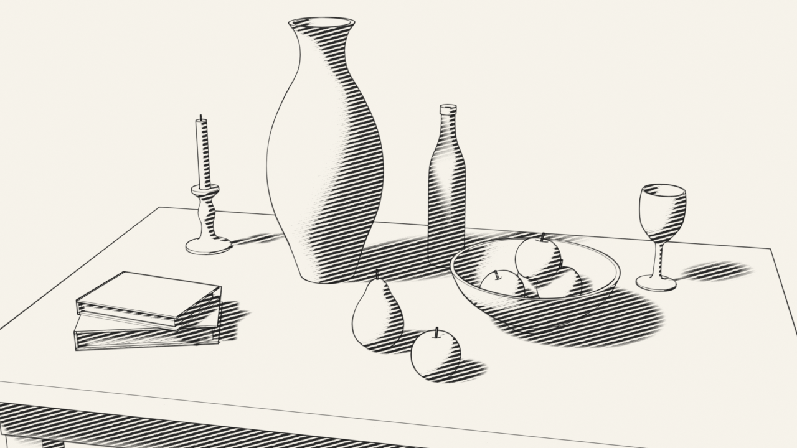
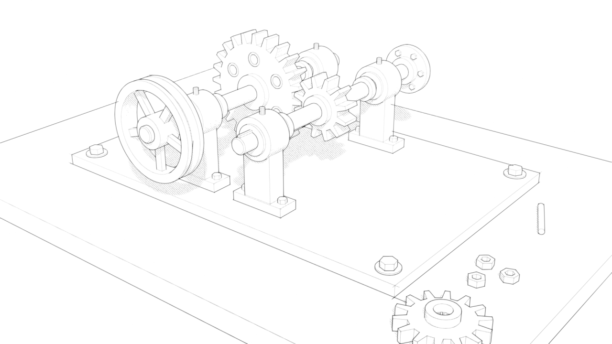
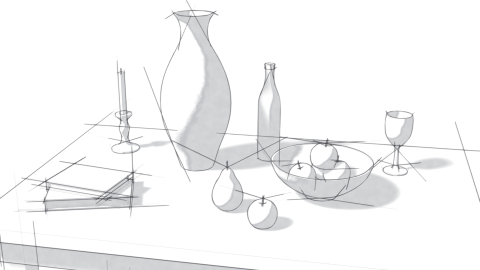
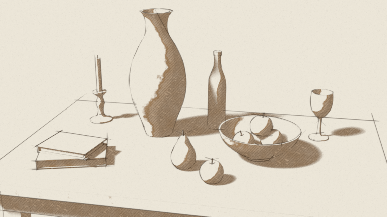
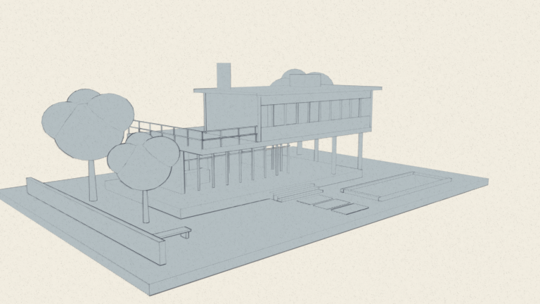
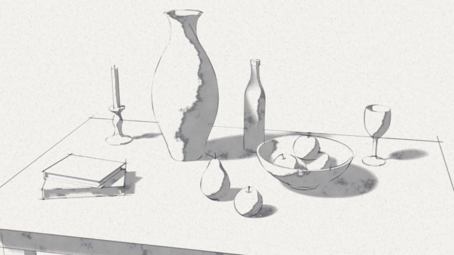
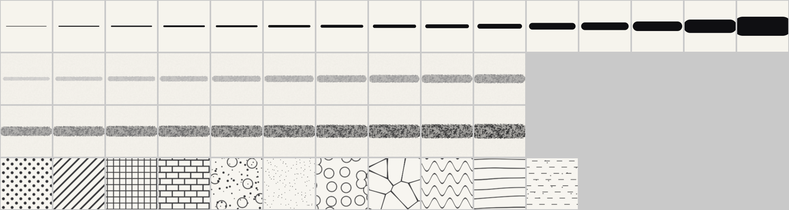

# Matita for Blender

**English** · [Italiano](README.it.md)

Matita turns any Blender scene into a hand-drawn illustration: ink or pencil lines,
hatching, screentones, architectural hatch patterns, watercolour washes and chalk highlights,
on paper with real grain. It ships 29 ready-made styles, from technical pen and patent drawings
to Leonardo, Michelangelo, Piranesi, Dürer, Rembrandt, Canaletto and Hokusai.



| | |
|---|---|
|  |  |
| *Three chalks (trois crayons) on toned paper* | *Architectural hatches assigned per object* |
|  |  |
| *Woodcut: highlights carved out of solid black* | *Patent drawing with ISO pen weights* |
|  |  |
| *Furniture / product design* | *Rembrandt: brown ink and dense washes* |
|  |  |
| *Hokusai: flat colours and indigo outlines* | *Ink wash (sumi-e) on washi paper* |
|  |  |
| *Fashion illustration* | *Visual menus: pen nibs, pencil grades 9H–9B, hatch patterns* |

> **Note:** the user interface is currently in **Italian**. This README describes every
> control with its Italian label in *italics*.

## Features

- **Lines** from Blender's Line Art: silhouettes, creases, intersections, construction lines
  and dashed hidden lines, with overshoot, repeated strokes, hand tremor and animated "boil".
- **Drawing tools** (*Strumento*): free width in pixels, **technical pen** (ISO 0.13–2.0 mm),
  **fineliner** (0.05–0.8 mm) or **pencil** (9H–9B), picked from visual menus. Pens can use
  a different nib for silhouettes, hidden and construction lines, as in technical drawing.
- **Sheet format** (*Formato foglio*): A5–A0 or automatic (300 dpi). It only converts nib
  millimetres into pixels: it does not depend on the model's scale or units.
- **Shading from the real scene lights**: cross/parallel/wavy/zigzag/scribble/weave/circle
  hatching, screentone, stippling, shadow fills and watercolour, all driven by Blender's own
  lights (the add-on never changes your lights; it adapts with *Esposizione*).
- **11 architectural hatch patterns** (*Retino*): dots, lines, grid, brick, concrete,
  sand/plaster, gravel, stone, insulation, wood, earth. Use them as a tone (in the shadows) or
  as a flat material fill, for the whole scene or **per object**.
- **Chalk highlights**, **woodcut (negative) hatching** and **per-object flat colours** taken
  from the original materials.
- **14 paper types** with grain, fibres and texture (laid, cold-press, canvas, washi, kraft,
  parchment...).
- **Fast on heavy scenes**: *Veloce* line mode, frozen lines, and *Ricongela da sole*, which
  keeps lines frozen while you select and orbit and recomputes them once when you stop moving.
- **Personal presets** saved as shareable `.json` files.
- **3 demo scenes** (architecture, mechanical, still life) to try every style.

## Styles

| Technical (*Tecnico*) | Artistic (*Artistico*) | Design | Masters (*VIP*) |
|---|---|---|---|
| Technical pen | Architectural sketch | Furniture & product | Leonardo |
| Blueprint | Pencil | Automotive | Michelangelo |
| Structure (all edges) | Stippling | Fashion | Piranesi |
| Patent drawing | Screentone | White model | Dürer |
| Chalkboard | Watercolour concept | Interior | Rembrandt |
| | Marker | | Canaletto |
| | Charcoal | | Hokusai |
| | Ink wash (sumi-e) | | |
| | Ligne claire | | |
| | Urban sketching | | |
| | Three chalks | | |
| | Woodcut | | |

## Requirements

- Blender **4.3 or newer** (developed and tested on Blender 5.3)
- EEVEE (set automatically when the add-on is activated)

## Installation

1. Download `matita-<version>.zip` from the
   [Releases](../../releases) page. Do not unzip it.
2. In Blender: *Edit › Preferences › Get Extensions*, open the menu in the top-right corner and
   choose **Install from Disk…**, then pick the zip.
3. Open the sidebar in the 3D viewport (`N`) and select the **Matita** tab.

If you installed a pre-release version under a different name, uninstall it first.

## Quick start

1. Pick a style from the *Stile* menu and press **Attiva Matita** (or try a demo from
   *Scene demo*).
2. Adjust the look in the sub-panels: *Carta* (paper), *Linee* (lines and drawing tool),
   *Tratteggio* (hatching), *Retino* (screentone and hatch patterns), *Acquerello* (wash),
   *Colore per oggetto*, *Lumeggiature* (highlights), *Luce e toni* (exposure).
3. Press **Render** in *Render e prestazioni*.

To assign an architectural hatch to an object: enable *Retino*, select the object, choose the
pattern under *Retino dell'oggetto*, and use *Applica ai selezionati* for the other objects.

## Performance tips

- Line Art recomputes all lines whenever the scene changes, **including when you just select
  an object**. On heavy scenes enable **Ricongela da sole** (in *Render e prestazioni*): lines
  stay frozen while you work and update once, half a second after you stop.
- With *Lock Camera to View* on, orbiting the camera view moves the camera, so every step
  recomputes the lines: *Ricongela da sole* fixes that too.
- *Calcolo linee: Veloce* skips intersections between objects (about 3× faster).

## Project structure

```
matita/              the extension (what goes into the zip)
  blender_manifest.toml     id, version, Blender version
  core.py                   scene setup, sync of settings, frozen lines, handlers
  nodes.py                  node trees: surface material and paper world
  props.py                  all settings (stored on the paper World) and object properties
  presets.py                built-in styles and personal presets
  papers.py / tips.py / tones.py   paper types, drawing tools, hatch patterns
  ui.py                     panels and operators
  scenes.py                 demo scenes
  papers/ tips/ tones/      preview icons of the visual menus
tools/                      scripts that regenerate the preview icons
docs/images/                pictures for this README
```

## Building the zip

```bash
blender --command extension build --source-dir matita --output-dir .
blender --command extension validate matita-<version>.zip
```

Preview icons are regenerated with:

```bash
blender --background --factory-startup --python tools/make_paper_previews.py
blender --background --factory-startup --python tools/make_tool_previews.py
```

## License

[GPL-3.0-or-later](LICENSE), like Blender itself.
The "Masters" styles are interpretations of public-domain artists' techniques; no artwork is
reproduced. All code, demo scenes, preview icons and pictures were created for this project
(the scenes and icons are generated procedurally by the add-on itself).

Blender is a registered trademark of the Blender Foundation. Matita is an independent
project and is not affiliated with or endorsed by the Blender Foundation.
